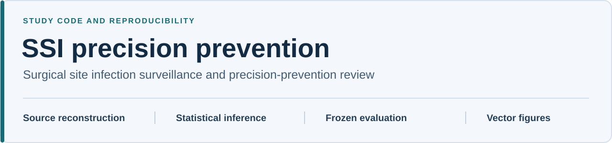

# SSI precision prevention

**Research software for surgical site infection surveillance and precision-prevention review.**

Source reconstruction, hospital-cluster statistical analyses, frozen-model evaluation, national microbiology analyses and vector figures for *Early surgical site infection signals across 6.7 million operations and procedure specific pathogen guide for prevention*.

**[Download the manuscript version](https://github.com/DrChambuso/ssi-precision-prevention/releases/tag/v1.0.0-rc2)** · **[Quick start](#quick-start)** · **[Analysis workflow](docs/PIPELINE.md)** · **[Model documentation](docs/FROZEN_MODEL.md)** · **[Figures](docs/FIGURES.md)**

> **Version 1.0.0-rc2 is a published, immutable release candidate.** The software license remains pending institutional approval. No open-source reuse license has been granted. [License status](LICENSE_PENDING.md) · [Version links](docs/PERMANENT_LINKS.md)

## Study at a glance

The study examines whether earlier SSI history can help prioritize surgical services for review of potential subsequent SSI burden, with procedure-specific microbiology providing complementary context for local prevention and stewardship.

| Surveillance scope | California hospital reports, 2016-2025 |
| :--- | ---: |
| Annual hospital-age-procedure reports | **72,854** |
| Operations | **6,737,972** |
| Reported surgical site infections | **37,525** |
| Surgical procedures | **28** |

The clinical purpose is precision-prevention review. The statistical prediction target is an annual observed SSI count above its source-predicted count. Capture measures subsequent reported burden reached by review; it does not measure infections prevented or predict an individual patient's infection onset. National NHSN microbiology summaries are a separate aggregate population, without linkage to California hospitals, patients, infection events or isolates.

## Choose your starting point

| Your task | Start here |
| :--- | :--- |
| Run the supplied example and tests | [Quick start](#quick-start) |
| Understand methods and resampling | [Analysis workflow](docs/PIPELINE.md) and [machine-readable specification](docs/analysis_specification.json) |
| Inspect or independently score the frozen model | [Model documentation](docs/FROZEN_MODEL.md) and [coefficients and scaling](model/) |
| Understand variables and source lineage | [Data dictionary](data/Data_dictionary.csv), [microbiology dictionary](data/Microbiology_data_dictionary.csv) and [provenance](provenance/) |
| Find final figures and regeneration instructions | [Figure guide](docs/FIGURES.md) and [figure crosswalk](provenance/figure_crosswalk.csv) |
| Assess reproducibility evidence | [Verification summary](#verification-evidence) and [independent computational review](docs/INDEPENDENT_REVIEW.md) |
| Cite the exact manuscript version | [Citation and version](#citation-and-version) |

## Quick start

Download and extract the [complete v1.0.0-rc2 package](https://github.com/DrChambuso/ssi-precision-prevention/releases/download/v1.0.0-rc2/Supplementary_Software_1_SSI_Code_v1.0.0-rc2.zip). From the extracted directory, create a Python environment and run the supplied checks:

```sh
python3 -m venv .venv
. .venv/bin/activate
python -m pip install -r environment/requirements-core.txt
python scripts/reconstruct_surveillance.py
python scripts/check_frozen_model.py --root .
python -m unittest discover -s tests -v
```

**Expected result:** surveillance reconstruction passes, all **180 frozen-model checks** pass and all **15 unit tests** pass. After dependency installation, these commands use the supplied aggregate data and frozen artifacts offline, without refitting the prediction model.

The core workflow was tested with **Python 3.12.14**. The full inferential workflow uses **R 4.5.0** and additional dependencies. No GPU is needed for the core example. The [environment guide](environment/README.md) records software versions, measured runtimes and the limits of the fresh-install validation.

<details>
<summary><strong>Optional: verify reconstruction against the original California CSV files</strong></summary>

```sh
python scripts/fetch_california_sources.py --destination data/raw/california
python scripts/reconstruct_surveillance.py --source-dir data/raw/california
```

The acquisition script requires network access and verifies retained SHA-256 values. It stops if a live source has changed. The supplied source-row crosswalk identifies the original file, row position, hospital/service identity and procedure. Historical acquisition dates that were not retained are marked unknown.

</details>

## Verification evidence

These are recorded checks of the manuscript-associated package, with the executed scope and limitations available for inspection.

| Check | Recorded result | Evidence |
| :--- | :--- | :--- |
| Source reconstruction | 78,583 retained source rows checked against 22 original California CSV files | [Reconstruction report](validation/surveillance_reconstruction.json) |
| Frozen-model scoring | 180 checks passed | [Frozen-model review](docs/INDEPENDENT_REVIEW.md) |
| Unit tests | 15 passed, including a fresh isolated core environment | [Executed review record](validation/independent_release_review.json) |
| Analytical and plotting workflow | 23 stages executed; 28 numerical table comparisons passed | [Pipeline validation](validation/pipeline_validation.json) |
| Final figure structure | 32 PDFs, 56 pages; no displayed raster image objects in the audit | [Vector audit](validation/vector_audit.json) |
| Selected final-layout regeneration | Main Figure 12 matched extracted text and rendered pixels at 144 dpi | [Regeneration comparison](validation/main12_regeneration_parity.json) |

Verification applies to the recorded inputs, commands and environments. Complete automatic regeneration of every historical final layout is not claimed. The [figure guide](docs/FIGURES.md) and [release checklist](docs/RELEASE_CHECKLIST.md) retain the outstanding manuscript and source-extraction boundaries. Historical validation documents record their preparation-time status; the [publication record](docs/PERMANENT_LINKS.md) provides the current release links.

## Repository map

| Directory | Purpose |
| :--- | :--- |
| [data/](data/) | Canonical annual aggregates, row crosswalks, prediction cohorts and dictionaries |
| [model/](model/) | 33 coefficients, four training centers/scales, serialized R fit and factor coding |
| [src/ssi_repro/](src/ssi_repro/) | Portable frozen scoring, ranking and capacity-dependent capture |
| [scripts/](scripts/) | Reconstruction, checks, pipeline runner and vector audit entry points |
| [pipeline_sources/](pipeline_sources/) | Path-adapted original statistical and plotting implementations |
| [reference_results/](reference_results/) | Retained numerical comparison targets and historical inputs |
| [figures/](figures/) | Final main-text and supplementary vector PDF masters |
| [figure_sources/](figure_sources/) | Retained SVGs and editorial finishing code |
| [docs/](docs/) | Methods, model, environment, figure and publication documentation |
| [provenance/](provenance/) | Source URLs, hashes, lineage and archived audits |
| [validation/](validation/) | Executed checks, numerical comparisons and logs |

<details>
<summary><strong>Key analytical conventions</strong></summary>

- One California record represents a hospital-age group-procedure-calendar year. Only exact calendar-year predecessors supply lags; missing reports are not quiet years.
- Nonoverlapping 2020 half-year counts are summed within the annual key. Overlapping annual versions are not added again.
- Feature transformations retain the specified 0.5 smoothing. Predictor centers and sample standard deviations use training data only; 2023-2025 targets do not enter fitting or scaling.
- Ranking scores are rounded to 12 significant digits. Boundary ties receive proportional inclusion within the same exact review budget.
- Signal-capture inference uses 1,999 whole-hospital draws, seed 20261016. Case-capture inference uses 1,999 multinomial hospital draws, seed 20261017. Their original implementations are retained separately.
- Multiplicity families, nonestimable-model rules and national microbiology denominators are defined in the [analysis specification](docs/analysis_specification.json).

</details>

## Citation and version

Please identify the fixed release when citing the manuscript-associated software:

> Chambuso R, Al Ani A, Mohamed ME, Albetar M. *SSI precision-prevention study: source reconstruction, statistical analysis and frozen-model evaluation*. Version 1.0.0-rc2. GitHub, 2026. https://github.com/DrChambuso/ssi-precision-prevention/releases/tag/v1.0.0-rc2

| Resource | Permanent version link |
| :--- | :--- |
| Manuscript-associated package | [Immutable release v1.0.0-rc2](https://github.com/DrChambuso/ssi-precision-prevention/releases/tag/v1.0.0-rc2) |
| Exact source snapshot | [Commit a83b2e94d0a6f6e87bacc8310d1471af02b21d16](https://github.com/DrChambuso/ssi-precision-prevention/tree/a83b2e94d0a6f6e87bacc8310d1471af02b21d16) |
| Machine-readable citation | [CITATION.cff](CITATION.cff) |
| Manuscript wording | [Code availability statement](docs/CODE_AVAILABILITY.md) |
| Download integrity | [Archive SHA-256 file](https://github.com/DrChambuso/ssi-precision-prevention/releases/download/v1.0.0-rc2/Supplementary_Software_1_SSI_Code_v1.0.0-rc2.zip.sha256) |

No DOI has been assigned. The default branch contains subsequent presentation and documentation updates; the immutable release and exact commit above identify the original published scientific package. Each tree's [integrity manifest](manifest.sha256) applies to that tree's files.

## License and correspondence

**Software license: pending institutional approval.** Public sharing is authorized, with no open-source reuse license granted. See [LICENSE_PENDING.md](LICENSE_PENDING.md) for the original code and [THIRD_PARTY_NOTICES.md](THIRD_PARTY_NOTICES.md) for the separate terms of source data, dependencies and other materials.

Scientific correspondence and licensing enquiries: **Ramadhani Chambuso**, Ajman University, [r.chambuso@ajman.ac.ae](mailto:r.chambuso@ajman.ac.ae). For a reproducibility question, include the version, command, software environment and relevant error output; exclude patient information and credentials.
